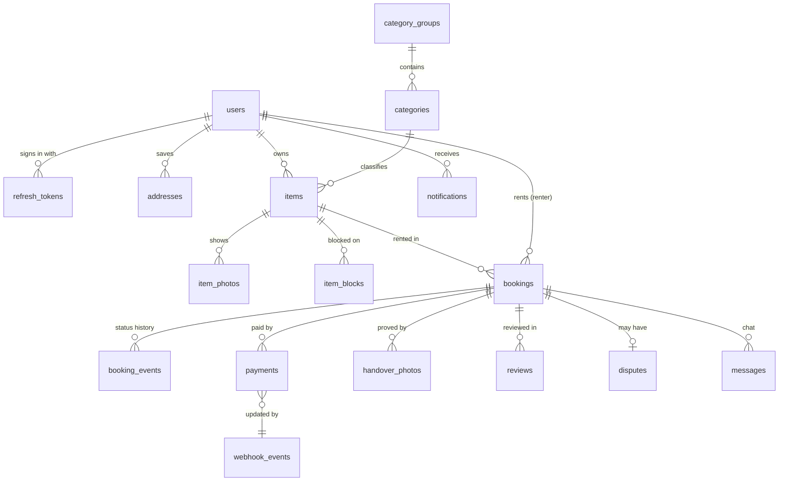
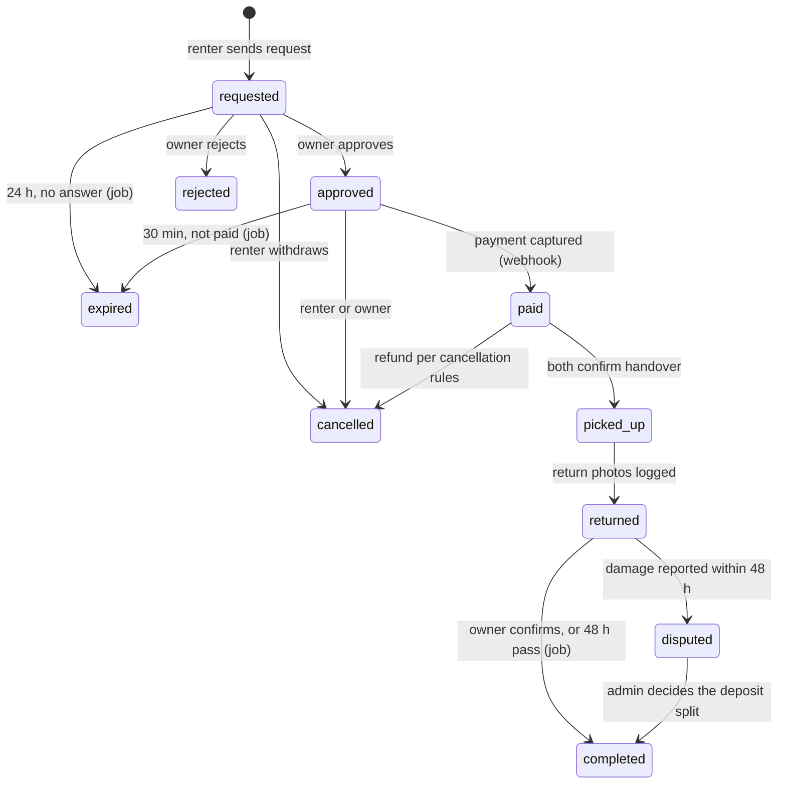

# RentXPlay API — data model

PostgreSQL (19 locally, 17 on Supabase), accessed only by this API through Prisma 7 ([ADR 0001 in the web repo](https://github.com/manavpatel123445/rentxplay-FE/blob/dev/docs/adr/0001-postgresql-on-supabase.md)). This document is the source of truth for tables, constraints and indexes; `prisma/schema.prisma` and `prisma/migrations/*_init/migration.sql` follow it.

**MVP without PostGIS.** Locations are plain `lat`/`lng` columns and distances use the haversine formula in SQL. That covers the delivery-radius check; nearby search (FR-12) is Phase 2, when PostGIS (built into Supabase) can be added with a `geography` column and a GiST index.

Sources: the PRD (`docs/01-PRD.md`), user flows (`docs/02-user-flows-and-wireframes.md`) and HLD (`docs/03-system-architecture-HLD.md`) in the web repo, plus decisions made since: Ahmedabad first, owner delivery for a fee, and "rent anything" (not only gadgets) using category groups.

## Conventions

| Rule | Why |
| --- | --- |
| Primary keys are `uuid` (`gen_random_uuid()`) | Safe to show in URLs; no guessable counts |
| Every table has `created_at` and `updated_at` (`timestamptz`, UTC) | Auditing and sorting |
| Money is stored as **integer paise** in columns ending `_paise` (`₹500` = `50000`) | No float rounding; Razorpay works in paise |
| Rental dates are `date` (no time) in Asia/Kolkata; timestamps are `timestamptz` | A rental is whole days; events are moments |
| Users and items are soft-deleted (`deleted_at`) | Past bookings and payments must keep their links |
| Prices and fees on a booking are **copied** at request time | Later edits to the listing never change an agreed price |
| Table names are plural `snake_case`; Prisma models are singular `PascalCase` | Prisma `@@map` keeps both readable |

## Entity relationships



## Enums

| Enum | Values |
| --- | --- |
| `user_role` | `user`, `admin` |
| `kyc_status` | `none`, `pending`, `verified`, `rejected` |
| `item_status` | `draft`, `pending_review`, `live`, `paused`, `rejected` |
| `item_condition` | `like_new`, `good`, `fair` |
| `handover` | `pickup`, `delivery` |
| `booking_status` | `requested`, `approved`, `paid`, `picked_up`, `returned`, `completed`, `rejected`, `expired`, `cancelled`, `disputed` |
| `payment_kind` | `charge` (rent + fees + deposit), `refund` (cancellation), `deposit_refund`, `deposit_claim` (kept by owner after a dispute) |
| `payment_status` | `created`, `pending`, `succeeded`, `failed` |
| `photo_stage` | `pickup`, `return` |
| `dispute_status` | `open`, `resolved` |

## Tables

### Identity

**`users`**

| Column | Type | Notes |
| --- | --- | --- |
| `id` | uuid PK | |
| `name` | text, **null** | Added after sign-up (`PATCH /me`); 2–60 characters |
| `email` | citext, unique | Lower-cased; login id |
| `phone` | text, **null**, unique | Saved only after OTP verification, as `+91XXXXXXXXXX`. Many users may have no phone (Postgres allows many NULLs in a unique index) |
| `phone_verified_at` | timestamptz, null | Set by OTP (FR-02) |
| `password_hash` | text | bcrypt, cost 12 |
| `role` | `user_role` | Default `user` |
| `kyc_status` | `kyc_status` | Mock KYC in Phase 2 (FR-05) |
| `avatar_url` | text, null | S3 key |
| `area` | text, null | Ahmedabad neighbourhood, for defaults |
| `rating_avg` | numeric(2,1), null | Cached from reviews about this user |
| `rating_count` | int | Default 0 |
| `strikes` | int | Owner cancellations after payment; 3 pauses listings |
| `blocked_at` | timestamptz, null | Admin block |
| `deleted_at` | timestamptz, null | |

**`refresh_tokens`** — one row per signed-in device; rotated on every refresh (FR-01).

| Column | Type | Notes |
| --- | --- | --- |
| `id` | uuid PK | Also the token family id |
| `user_id` | uuid FK → users | |
| `token_hash` | text, unique | SHA-256 of the token; the token itself is never stored |
| `expires_at` | timestamptz | 30 days |
| `revoked_at` | timestamptz, null | Set on logout or reuse detection |
| `replaced_by` | uuid, null | Next token in the rotation chain |
| `user_agent`, `ip` | text, null | Shown in "your devices" later |

OTP codes, rate-limit counters and login attempt counts live in **Redis** with TTLs, not in Postgres.

**`addresses`** — delivery addresses a renter saves.

| Column | Type | Notes |
| --- | --- | --- |
| `id` | uuid PK | |
| `user_id` | uuid FK → users | |
| `label` | text | "Home", "Office" |
| `line1`, `line2`, `area`, `pincode` | text | `pincode` 6 digits |
| `lat`, `lng` | double precision | For the owner's delivery radius check |

### Catalogue

**`category_groups`** — top level ("Electronics", "Events & parties", "Travel & outdoor", "Tools & home"; later "Fashion", "Sports", "Baby & kids").

| Column | Type | Notes |
| --- | --- | --- |
| `id` | uuid PK | |
| `slug` | text, unique | `electronics` |
| `name` | text | |
| `position` | int | Display order |
| `is_active` | boolean | Launch only some groups |

**`categories`**

| Column | Type | Notes |
| --- | --- | --- |
| `id` | uuid PK | |
| `group_id` | uuid FK → category_groups | |
| `slug` | text, unique | `cameras`, `gaming`, `tents` |
| `name` | text | |
| `spec_schema` | jsonb | Fields owners fill in, e.g. `[{"key":"sensor","label":"Sensor","type":"text"}]` |
| `rules_note` | text, null | Category-specific rule shown on the item page (cleaning for clothes, safety for tools) |
| `position`, `is_active` | int, boolean | |

**`items`** — one listing.

| Column | Type | Notes |
| --- | --- | --- |
| `id` | uuid PK | |
| `owner_id` | uuid FK → users | |
| `category_id` | uuid FK → categories | |
| `slug` | text, unique | `ps5-2-controllers-3f9a`; used in web URLs |
| `title` | text | 5–80 characters |
| `description` | text | Up to 2,000 characters |
| `in_the_box` | text[] | |
| `condition` | `item_condition` | |
| `specs` | jsonb | Values for the category's `spec_schema` |
| `price_1d_paise` | int | Per-day rate for 1–2 days |
| `price_3d_paise` | int | Per-day rate for 3–6 days |
| `price_7d_paise` | int | Per-day rate for 7+ days |
| `deposit_paise` | int | Refundable |
| `delivery_fee_paise` | int, null | Null = pickup only |
| `delivery_radius_km` | int, null | Required when delivery is offered |
| `min_days`, `max_days` | int | 1–30 |
| `area` | text | Neighbourhood shown publicly |
| `lat`, `lng` | double precision | Exact point, never returned to the public API; used for distance |
| `pickup_instructions` | text, null | Shown only after payment |
| `status` | `item_status` | MVP: new listings go `live` straight away; Phase 2: `pending_review` |
| `rejection_reason` | text, null | |
| `rating_avg`, `rating_count` | numeric(2,1), int | Cached from reviews |
| `deleted_at` | timestamptz, null | |

**`item_photos`**

| Column | Type | Notes |
| --- | --- | --- |
| `id` | uuid PK | |
| `item_id` | uuid FK → items | |
| `s3_key` | text | Uploaded by the client with a pre-signed URL |
| `position` | int | 0 = cover |
| `width`, `height` | int | |

**`item_blocks`** — dates the owner blocks manually (FR-08).

| Column | Type | Notes |
| --- | --- | --- |
| `id` | uuid PK | |
| `item_id` | uuid FK → items | |
| `from_date`, `to_date` | date | Inclusive; `to_date >= from_date` |
| `reason` | text, null | Private to the owner |

### Bookings and money

**`bookings`**

| Column | Type | Notes |
| --- | --- | --- |
| `id` | uuid PK | |
| `code` | text, unique | Short public reference, e.g. `RX-1042` |
| `item_id` | uuid FK → items | |
| `renter_id` | uuid FK → users | |
| `owner_id` | uuid FK → users | Copied from the item for fast "my requests" queries |
| `start_date`, `end_date` | date | Pickup and return day; `end_date > start_date` |
| `days` | int | `end_date - start_date`, enforced by a `CHECK` |
| `handover` | `handover` | |
| `delivery_address` | jsonb, null | Snapshot of the address at request time |
| `rate_paise` | int | Tier rate applied (copied) |
| `rent_paise` | int | `rate × days` |
| `service_fee_paise` | int | 10% of rent, rounded |
| `delivery_fee_paise` | int | 0 for pickup |
| `deposit_paise` | int | Copied |
| `commission_paise` | int | 5% of rent, kept from the owner |
| `total_paise` | int | rent + service fee + delivery fee + deposit |
| `late_fee_paise` | int | Default 0; 1.5 × 1-day rate per late day, taken from the deposit |
| `status` | `booking_status` | See the lifecycle below |
| `expires_at` | timestamptz, null | Request: +24 h; approved: +30 min to pay |
| `approved_at`, `paid_at`, `picked_up_at`, `returned_at`, `completed_at`, `cancelled_at` | timestamptz, null | |
| `cancelled_by` | uuid, null | Renter or owner |
| `cancel_reason` | text, null | |

**`booking_events`** — append-only history of every status change (who, when, from → to). Used for the timeline on S09 and for audits.

| Column | Type | Notes |
| --- | --- | --- |
| `id` | bigint identity PK | |
| `booking_id` | uuid FK → bookings | |
| `actor_id` | uuid, null | Null = system job |
| `from_status`, `to_status` | `booking_status` | |
| `note` | text, null | |
| `created_at` | timestamptz | |

**`payments`**

| Column | Type | Notes |
| --- | --- | --- |
| `id` | uuid PK | |
| `booking_id` | uuid FK → bookings | |
| `kind` | `payment_kind` | |
| `amount_paise` | int | Always positive; `kind` says which way it moves |
| `status` | `payment_status` | |
| `razorpay_order_id` | text, unique, null | For `charge` |
| `razorpay_payment_id` | text, unique, null | |
| `razorpay_refund_id` | text, unique, null | For refunds |
| `idempotency_key` | text, unique | From the client's `Idempotency-Key` header or generated by a job |
| `failure_reason` | text, null | |

**`webhook_events`** — every Razorpay webhook, stored before processing.

| Column | Type | Notes |
| --- | --- | --- |
| `id` | text PK | Razorpay's event id: a repeat delivery hits the PK and is skipped |
| `event` | text | `payment.captured`, `refund.processed`… |
| `payload` | jsonb | |
| `processed_at` | timestamptz, null | |

### Trust and communication

**`handover_photos`** — `booking_id`, `uploaded_by`, `stage` (`pickup` / `return`), `s3_key`, `taken_at`. Evidence for disputes (FR-23).

**`reviews`** — `booking_id`, `author_id`, `subject_id` (the other person), `item_id` (null when reviewing a renter), `rating` 1–5, `text` up to 1,000 characters. Unique on `(booking_id, author_id)`: one review each way per booking (FR-24).

**`disputes`** — `booking_id` (unique), `opened_by`, `reason`, `claim_paise`, `status`, `resolved_by` (admin), `owner_keeps_paise`, `resolution_note`, `resolved_at`. Must be opened within 48 hours of `returned_at` (FR-25).

**`messages`** — `booking_id`, `sender_id`, `body` (up to 2,000 characters), `photo_s3_key`, `read_at`. Chat is per booking (FR-26).

**`notifications`** — `user_id`, `type` (`booking_requested`, `booking_approved`, `payment_due`, `return_reminder`…), `data` jsonb, `read_at`. Email and push are sent by BullMQ workers; this table backs the in-app list (S12).

## Constraints that protect the business rules

```sql
-- 1. No double booking (PRD FR-15). Active bookings of the same item may not overlap.
CREATE EXTENSION IF NOT EXISTS btree_gist;
ALTER TABLE bookings ADD CONSTRAINT bookings_no_overlap
  EXCLUDE USING gist (item_id WITH =, daterange(start_date, end_date, '[)') WITH &&)
  WHERE (status IN ('approved', 'paid', 'picked_up'));

-- 2. Sane dates and money.
ALTER TABLE bookings ADD CONSTRAINT bookings_dates CHECK (end_date > start_date);
ALTER TABLE bookings ADD CONSTRAINT bookings_not_own_item CHECK (renter_id <> owner_id);
ALTER TABLE items ADD CONSTRAINT items_prices CHECK (
  price_1d_paise > 0 AND price_3d_paise > 0 AND price_7d_paise > 0
  AND price_3d_paise <= price_1d_paise AND price_7d_paise <= price_3d_paise
  AND deposit_paise >= 0
);
ALTER TABLE items ADD CONSTRAINT items_days CHECK (min_days >= 1 AND max_days >= min_days AND max_days <= 30);
ALTER TABLE items ADD CONSTRAINT items_delivery CHECK (
  (delivery_fee_paise IS NULL AND delivery_radius_km IS NULL)
  OR (delivery_fee_paise >= 0 AND delivery_radius_km BETWEEN 1 AND 50)
);
ALTER TABLE reviews ADD CONSTRAINT reviews_rating CHECK (rating BETWEEN 1 AND 5);
```

Owner-blocked dates live in another table, so the exclusion constraint cannot see them. The approve transaction checks them instead:

1. `SELECT … FROM items WHERE id = $1 FOR UPDATE` (serialises approvals for one item).
2. Reject if any block overlaps: `from_date < booking.end_date AND to_date >= booking.start_date`.
3. Update the booking to `approved`; the exclusion constraint rejects any overlap with another active booking (Postgres error `23P01` → API `409 dates_taken`).

## Indexes

| Index | Serves |
| --- | --- |
| `items (category_id, status) WHERE deleted_at IS NULL` | Category browse |
| `items (area)` | MVP area filter and sort |
| Phase 2: `items USING gist (location)`, `USING gin (to_tsvector(…))` | Nearby and full-text search, added with PostGIS |
| `items (owner_id)` | "My listings" |
| `item_blocks (item_id, from_date)` | Availability checks |
| `bookings (renter_id, status, start_date DESC)` | Renter's "My bookings" tabs |
| `bookings (owner_id, status, created_at DESC)` | Owner's requests inbox |
| `bookings (status, expires_at) WHERE expires_at IS NOT NULL` | Expiry jobs |
| `payments (booking_id)` | Booking detail |
| `messages (booking_id, created_at)` | Chat history |
| `notifications (user_id, read_at, created_at DESC)` | Unread badge and list |
| `refresh_tokens (user_id) WHERE revoked_at IS NULL` | Logout everywhere |

## Booking lifecycle



Every change goes through one function, `transitionBooking(bookingId, toStatus, actor)`, which checks the allowed move, writes `booking_events`, and queues notifications in the same transaction.

## Prisma notes

- The `citext` and `btree_gist` extensions, the exclusion constraint and the `CHECK`s are hand-written at the top and bottom of the init migration (`prisma migrate dev --create-only`, then edit). A follow-up `migrate dev` produced an empty migration, so Prisma sees no drift.
- Supabase needs `btree_gist`, `citext` and `pgcrypto` enabled (plus `postgis` in Phase 2), and RLS on every table with no policies.
- Two URLs: `DATABASE_URL` (pooled, port 6543, `?pgbouncer=true`) and `DIRECT_URL` (port 5432, migrations).

## Seed data

`prisma/seed.ts` creates the 4 launch category groups, 14 categories, 6 demo users (one admin) and the 8 demo items the web app already shows, with fictional names in Ahmedabad areas. Passwords come from `SEED_PASSWORD` in `.env`, never from the code.
